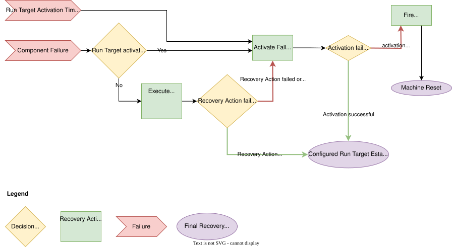

..
   # *******************************************************************************
   # Copyright (c) 2025 Contributors to the Eclipse Foundation
   #
   # See the NOTICE file(s) distributed with this work for additional
   # information regarding copyright ownership.
   #
   # This program and the accompanying materials are made available under the
   # terms of the Apache License Version 2.0 which is available at
   # https://www.apache.org/licenses/LICENSE-2.0
   #
   # SPDX-License-Identifier: Apache-2.0
   # *******************************************************************************

Recovery Actions
################

The following diagram gives an overview of the recovery escalation.

   Recovery action escalation chain

.. note::
   It is planned to support more Run Target Recovery Actions in the future, e.g. switching to a different
   Run Target than the Fallback Run Target.

   .. dropdown:: Show the planned escalation chain
      :animate: fade-in-slide-down

      .. figure:: _assets/recovery_actions.drawio.svg
         :align: center
         :alt: Planned escalation with a configurable Run Target Recovery Action between the
               Component Recovery Action and the Fallback Run Target

         Planned recovery action escalation chain. In contrast to the diagram above, the
         Run Target Recovery Action is now a separate step in the escalation chain.

A Component Failure is first handled by the Component Recovery Action. A Component Recovery Action may be to simply try
restarting the failed component. If no Component Recovery Action is configured or it does
not succeed, the Run Target Recovery Action activates the Fallback Run Target. If this also fails,
the Watchdog triggers a Machine Reset.
Currently, the Run Target Recovery Action is synonymous with activation of the Fallback Run Target.

The Fallback Run Target is a special Run Target defined in the Launch Manager configuration (see :need:`feat_arc_sta__lifecycle__cfg_params_static`); it shall be used as
a minimal system state that allows diagnosis of the failure. The State Manager is expected to transition the system out of the Fallback Run Target to
retry normal operation.

The following sequence diagrams are based on the example dependency graph described
in :doc:`./components_run_targets`.

The configurable recovery actions are shown as `ComponentRecoveryAction` and
`RunTargetRecoveryAction` in
:ref:`Configuration Structure <lifecycle_configuration_structure>`.

Component failure
=================

A component may fail outside of a Run Target transition for one of the following reasons:

* The component's underlying process crashes
* The component supervision fails (e.g. the component does not send alive notifications at the expected frequency)

Component crash
---------------

.. feat_arc_dyn:: Launch Manager - Crash Recovery
   :id: feat_arc_dyn__lifecycle__crash
   :security: YES
   :status: valid
   :version: 1
   :safety: ASIL_B
   :belongs_to: feat__lifecycle[version==1]
   :fulfils: feat_req__lifecycle__monitor_processes[version==1],
             feat_req__lifecycle__recovery_action_support[version==1]

   .. uml:: _assets/launch_manager_random_crash.puml
      :scale: 50
      :align: center

   The diagram shows a component crash during an active Run Target (outside of a Run Target transition).
   The component can be configured with a recovery action that defines the reaction to a crash.
   If a Restart Recovery Action is configured then only the crashed component is restarted, not dependent components.
   If the restart fails, the next recovery stage is to execute the Run Target Recovery Action, i.e. activating the Fallback Run Target.
   See :need:`feat_arc_dyn__lifecycle__run_target_failure` for reference.

Component supervision failure
-----------------------------

.. feat_arc_dyn:: Launch Manager - Supervision Failure
   :id: feat_arc_dyn__lifecycle__sup_failure
   :security: YES
   :status: valid
   :version: 1
   :safety: ASIL_B
   :belongs_to: feat__lifecycle[version==1]
   :fulfils: feat_req__lifecycle__monitor_processes[version==1],
             feat_req__lifecycle__recovery_action_support[version==1]

   .. uml:: _assets/launch_manager_supervision_failure.puml
      :scale: 50
      :align: center

   The diagram shows a component supervision failure during an active Run Target (outside of a Run Target transition).
   For details of detecting supervision failures, see :need:`feat_arc_dyn__lifecycle__alive_monitor_start`.
   The subsequent recovery behavior is identical to the process crash scenario in :need:`feat_arc_dyn__lifecycle__crash`.

Run Target transition failure
=============================

A Run Target transition might fail for the following reasons:

- A component failed to activate within its timeout (exceeding its configured activation retries)
- A Run Target transition exceeds its configured transition timeout
- A component that is already active fails while the transition is still ongoing

If a Run Target transition fails, the Launch Manager executes the Run Target Recovery Action as configured for the affected Run Target.
The currently only supported Run Target Recovery Action is the activation of the `fallback Run Target`.

.. feat_arc_dyn:: Launch Manager - Run Target Transition Failure
   :id: feat_arc_dyn__lifecycle__run_target_failure
   :security: YES
   :status: valid
   :version: 1
   :safety: ASIL_B
   :belongs_to: feat__lifecycle[version==1]
   :fulfils: feat_req__lifecycle__recovery_action_support[version==1]

   .. uml:: _assets/launch_manager_run_target_failure.puml
      :scale: 50
      :align: center

   The diagram shows a failing Run Target transition from Run Target "Minimal" to Run Target "Running".
   Component app1 does not reach its ready condition, even after all configured activation attempts have been
   exhausted, which makes the whole transition fail.
   The Launch Manager then executes the Run Target Recovery Action of Run Target "Running" and activates the
   Fallback Run Target. Components that are not part of the Fallback Run Target are deactivated; components
   that were never activated stay deactivated.

